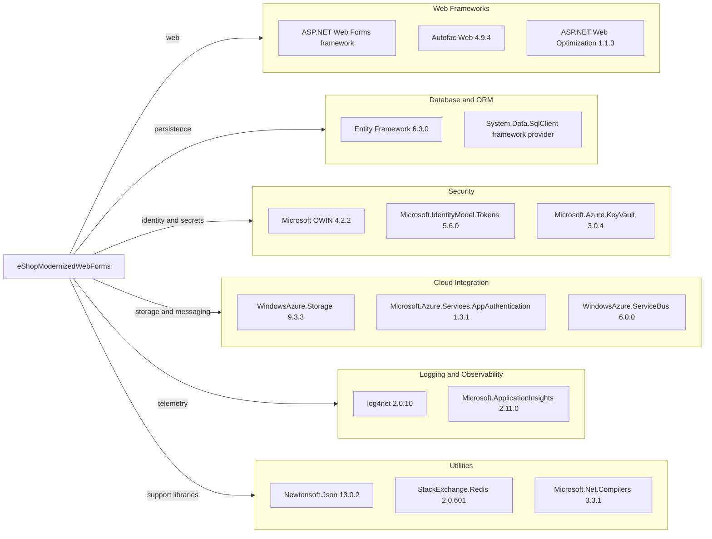

# Dependency Map

The eShopModernizedWebForms project targets .NET Framework 4.7.2 and declares 147 NuGet packages in `packages.config`.

## Dependencies

### Dependency Summary

| Category | Count shown | Key Libraries | Notes |
|---|---:|---|---|
| Web Frameworks | 3 | ASP.NET Web Forms, Autofac.Web, ASP.NET Web Optimization | Legacy System.Web hosting model |
| Database / ORM | 2 | EntityFramework 6.3.0, System.Data.SqlClient | SQL Server access |
| Security | 3 | OWIN, Microsoft.IdentityModel, Azure Key Vault | Authentication and secret configuration |
| Cloud Integration | 3 | WindowsAzure.Storage, Azure Services AppAuthentication, WindowsAzure.ServiceBus | Optional Azure integrations |
| Logging / Observability | 2 | log4net, Application Insights | Application logs and telemetry |
| Utilities | 3 | Newtonsoft.Json, StackExchange.Redis, Microsoft.Net.Compilers | JSON, optional session store client, build-time compiler |

### Version & Compatibility Risks

The application targets .NET Framework 4.7.2 and uses the legacy Web Forms/System.Web stack. Several dependencies are older major versions, including Entity Framework 6.3.0, Azure Storage 9.3.3, and IdentityModel 5.6.0; compatibility must be checked when moving to modern .NET.

### Notable Observations

- `packages.config` declares 147 packages, including many framework compatibility packages.
- Azure storage, Azure Active Directory, and Key Vault integrations are controlled by application settings and may be unused in the default configuration.
- The project has separate `Microsoft.ApplicationInsights.*` packages for web tracking and telemetry collection.
- `Microsoft.Net.Compilers` is marked as a development dependency; it is a build-time dependency rather than a runtime service library.

## Test Dependencies

| Framework | Version | Notes |
|---|---|---|
| None detected | — | No test-scoped packages or test project are included in this solution. |

Total test-scope dependencies: 0

No test dependencies were detected in the project package manifest.
