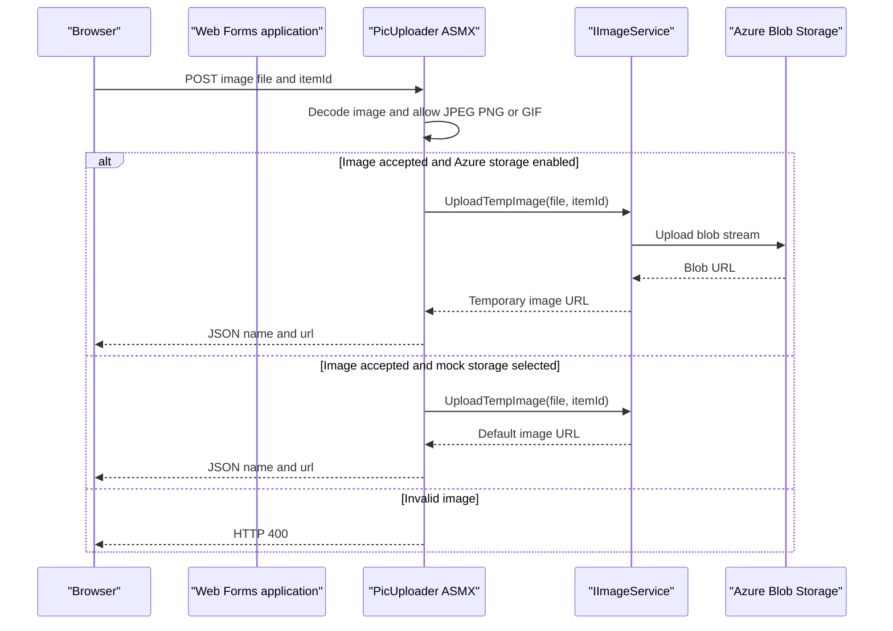

# API & Service Communication Contracts

The application exposes server-rendered catalog pages and one ASMX image-upload method. It does not expose a versioned REST API or a service-to-service API layer.

## Service Catalog

| Service | Port | Category | Purpose |
|---|---|---|---|
| eShopModernizedWebForms | Container port 80; Compose host port 5114; IIS Express 44322 | API Layer / Web application | Displays and administers catalog data |
| SQL Server container | 1433; Compose host port 5433 | Infrastructure | Relational catalog persistence in the Compose configuration |

## API Endpoints Inventory

| Service | Method | Path | Request Type | Response Type |
|---|---|---|---|---|
| WebForms application | GET | `/Default` | Optional route pagination values | Rendered catalog HTML |
| WebForms application | GET | `/Default/index/{index}/size/{size}` | Route values | Rendered catalog page |
| WebForms application | GET, POST | `/Catalog/Create` | Web Forms fields and postback | Rendered form or redirect |
| WebForms application | GET, POST | `/Catalog/Edit/{id}` | Route ID and Web Forms fields | Rendered form or redirect |
| WebForms application | GET | `/Catalog/Details/{id}` | Route ID | Rendered item details |
| WebForms application | GET, POST | `/Catalog/Delete/{id}` | Route ID and postback | Confirmation page or redirect |
| WebForms application | POST | `/Catalog/PicUploader.asmx/UploadImage` | Multipart file field `HelpSectionImages` and form field `itemId` | JSON object containing image name and URL |

No API versioning scheme or OpenAPI specification was found. Standard Web Forms controls and page postbacks provide the catalog administration requests; the ASMX method is the only explicit service endpoint.

## Management & Observability Endpoints

| Service | Endpoint | Custom Metrics |
|---|---|---|
| eShopModernizedWebForms | No application health or metrics endpoint found | No custom metric registrations found; Application Insights telemetry is configured |

## DTOs & Contracts

There are no dedicated request/response DTO classes. `CatalogItem` is the catalog entity used by the service and Web Forms pages; `PaginatedItemsViewModel<CatalogItem>` carries listing results. `PicUploader.UploadImage` returns an anonymous JSON object with `name` and `url` properties. The response is serialized with `JavaScriptSerializer`. No immutable record DTOs, protobuf schemas, GraphQL schemas, or OpenAPI documents were found.

## Communication Patterns

Browser requests and Web Forms postbacks are synchronous. `CatalogService` uses EF6 against SQL Server, and `ImageAzureStorage` calls Azure Blob Storage when enabled; the alternative mock service serves local seeded data. The application does not implement a gateway, service discovery, asynchronous messaging workflow, retry policy, circuit breaker, or bulkhead. A Service Bus package is declared, but no runtime message-broker use was identified.

OpenID Connect with cookies is configured conditionally through OWIN and Azure Active Directory. The Create, Edit, and Delete pages issue a sign-in challenge when the request is unauthenticated. When Azure Active Directory is disabled, the configured fallback middleware constructs a claims identity locally rather than performing an external sign-in. No role-based authorization checks or application-level HTTPS enforcement were found. Image upload authorization is not checked in `PicUploader.UploadImage`.

## Service Technology Matrix

| Service | Web | Data Access | Discovery | Gateway | Health | Cache | Metrics |
|---|---|---|---|---|---|---|---|
| eShopModernizedWebForms | ASP.NET Web Forms and ASMX | EF6 / SQL Server | None | None | None detected | Optional Redis session provider; sample config inactive | Application Insights |
| SQL Server container | SQL Server | Relational database | None | None | Compose health check | None | None |

## Service Communication Sequence

