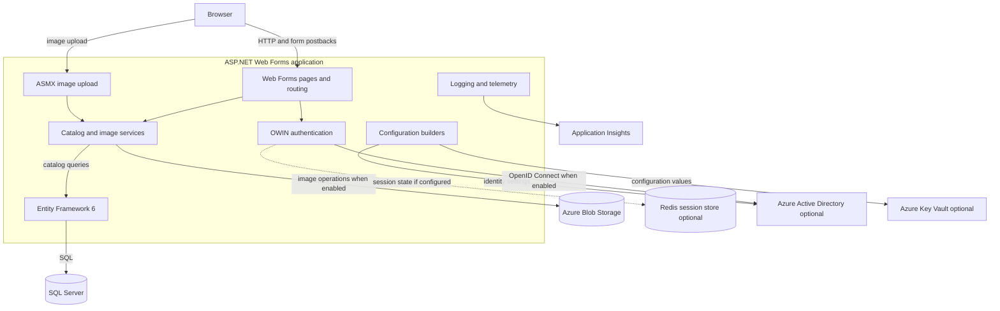
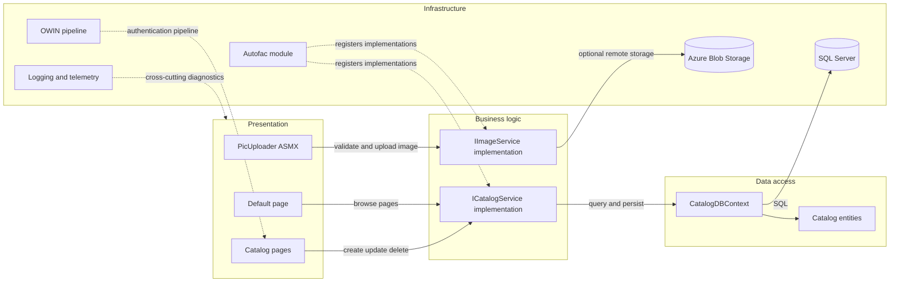

# Architecture Diagram

The application is a server-rendered catalog management website with an optional image-upload endpoint. It runs as a single .NET Framework application and uses configuration-selected implementations for data, identity, and image storage.

## Application Architecture

### Technology Stack Summary

| Layer | Technology | Version | Purpose |
|---|---|---:|---|
| Presentation | ASP.NET Web Forms | .NET Framework 4.7.2 | Server-rendered catalog and administration pages |
| Business logic | C# and Autofac | Autofac 4.9.4 | Catalog and image services with dependency injection |
| Data access | Entity Framework | 6.3.0 | SQL Server persistence |
| Identity | OWIN and OpenID Connect | OWIN.Security.OpenIdConnect 4.0.1 | Optional Azure Active Directory sign-in |
| Image storage | Azure Storage client | 9.3.3 | Optional Azure Blob image storage |
| Observability | log4net and Application Insights | 2.0.10 / 2.11.0 | Application logging and telemetry |

### Data Storage & External Services

Catalog records are stored in SQL Server through Entity Framework 6. Azure Blob Storage is an optional image backend; local images are used by the mock implementation. Azure Active Directory, Key Vault, Application Insights, and Redis-backed session state are configuration-dependent integrations. No message broker communication was found in the application source.

### Key Architectural Decisions

- Autofac selects mock or database-backed catalog services and local or Azure image storage from configuration.
- Entity Framework owns relational persistence; catalog images are stored separately from catalog metadata.
- The application uses server-rendered Web Forms and an ASMX method rather than a separate REST API or gateway.

## Component Relationships

### Component Inventory

| Component | Layer | Type | Responsibility |
|---|---|---|---|
| Default page | Presentation | Web Forms page | Lists catalog items and paginates results |
| Create, Edit, Details, Delete | Presentation | Web Forms pages | Catalog item administration and display |
| PicUploader | Presentation | ASMX WebMethod | Validates and uploads image content |
| CatalogService / CatalogServiceMock | Business logic | Service implementations | Reads and mutates catalog records |
| ImageAzureStorage / ImageMockStorage | Business logic | Image service implementations | Stores or resolves catalog images |
| CatalogDBContext | Data access | Entity Framework DbContext | Maps catalog entities to SQL Server |
| ApplicationModule | Infrastructure | Autofac module | Registers lifetime and configuration-selected services |
| Startup and OWIN middleware | Infrastructure | Authentication pipeline | Enables OpenID Connect or the configured fallback |
| Global | Infrastructure | ASP.NET application lifecycle | Initializes routes, dependency injection, database, images, and telemetry |
