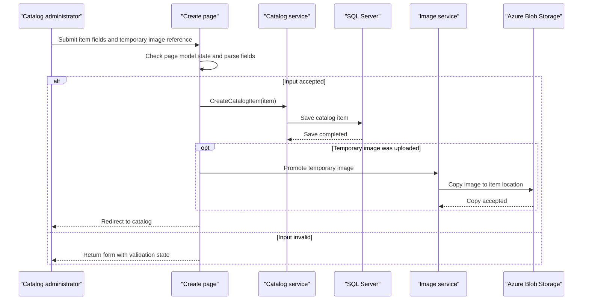

# Core Business Workflows

The application supports browsing a product catalog and maintaining catalog items, brands, types, stock levels, and product images. Its workflows are handled within one Web Forms application rather than across independently deployed business services.

## Domain Entities

| Entity | Service / Bounded Context | Description | Key Relationships |
|---|---|---|---|
| CatalogItem | Catalog management | Product offered in the catalog, with price, stock, and image reference | Belongs to one CatalogBrand and one CatalogType |
| CatalogBrand | Catalog management | Brand associated with catalog items | Can be referenced by many CatalogItems |
| CatalogType | Catalog management | Category/type associated with catalog items | Can be referenced by many CatalogItems |

## Service-to-Domain Mapping

| Service | Domain Context | Owned Entities | External Dependencies |
|---|---|---|---|
| eShopModernizedWebForms | Catalog management | CatalogItem, CatalogBrand, CatalogType | SQL Server through EF6; optional Azure Blob Storage for images |

The application is a single bounded context. No inter-service events or remote domain APIs were identified.

## Primary Workflows

### Workflow 1: Browse the catalog

1. A visitor opens the default page or a route containing pagination values.
2. The page requests a catalog page from `ICatalogService`.
3. The service loads items and their brand/type relationships from the selected database or mock provider.
4. The page resolves image URLs and renders the page. When mock mode is active, the service uses its in-memory seeded list.

### Workflow 2: Create or update a catalog item

1. An administrator opens the create or edit page; the page triggers an OpenID Connect challenge when the request is not authenticated.
2. The browser submits the item fields and selected brand/type.
3. The page checks `ModelState`, parses numeric fields, and constructs a `CatalogItem`.
4. The catalog service assigns or uses the item ID and persists the item.
5. If a temporary image is present, the image service promotes it to the item's image location and the page redirects to the catalog.

### Workflow 3: Upload a catalog image

1. The browser posts the image and item ID to `PicUploader.UploadImage`.
2. The endpoint decodes the upload and accepts JPEG, PNG, or GIF image formats.
3. The configured image service stores the file in Azure Blob Storage when enabled, or returns the mock implementation's configured image behavior.
4. The endpoint returns the image name and URL as JSON for use by the catalog form.

### Workflow 4: Delete a catalog item

1. An administrator opens the delete page, which challenges unauthenticated users when configured.
2. The page resolves the catalog item by route ID.
3. On postback confirmation, the catalog service removes the entity and the page redirects.

## Cross-Service Data Flows

No cross-service aggregation or domain data exchange was found. Catalog metadata is sourced from the local SQL Server database or mock list. Images are stored separately through the optional Azure Blob backend; the application combines the image URL with catalog item data when rendering pages.

## Business Workflow Sequence

## Business Rules & Decision Logic

- Catalog items require an associated brand and type; EF mappings define these required relationships.
- Price is constrained to non-negative values with at most two decimal places. Stock, restock threshold, and maximum stock values are range-constrained in the model.
- The application selects database-backed or mock catalog storage, and local or Azure image storage, from feature settings.
- A new catalog item ID is allocated through the HiLo sequence in database mode or from the current maximum ID in mock mode.
- EF `SaveChanges` persists catalog mutations; no distributed transaction, saga, or message-driven workflow was found.
- Page code logs request entry and uses OWIN authentication configuration for selected administrative pages; no role-specific business authorization was identified.
