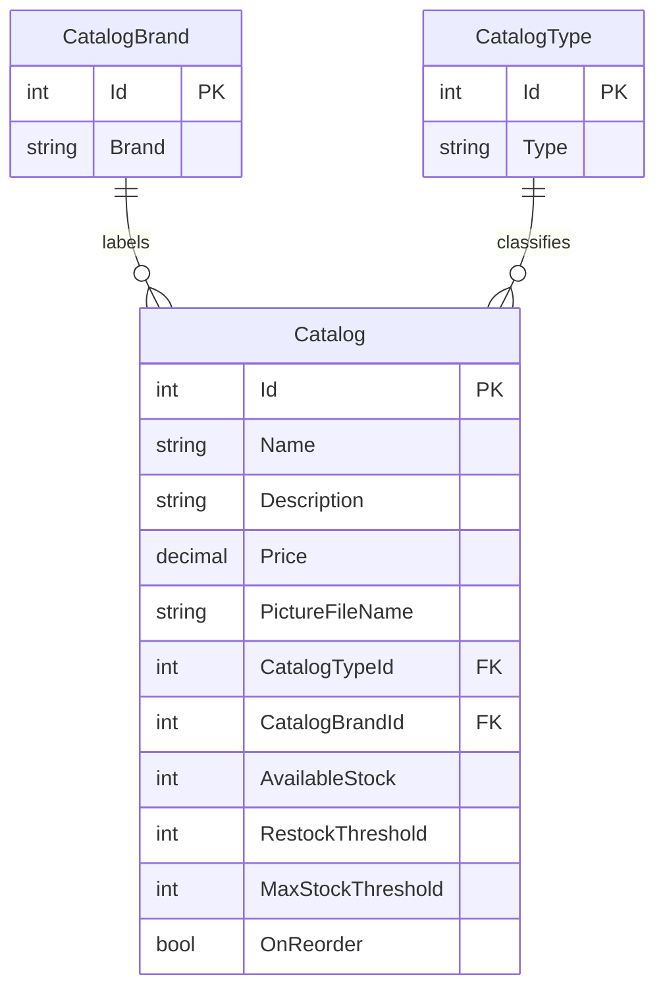

# Data Architecture & Persistence Layer

The application persists a small catalog domain in SQL Server through Entity Framework 6. The model contains three relational entities, with optional mock data and image storage used for local or configured deployments.

## Database Configuration

| Service/Module | DB Type | Profile | Driver | Connection | Migration Tool |
|---|---|---|---|---|---|
| Catalog application | SQL Server | Database-backed mode | EF6 SQL Server provider | `CatalogDBContext` connection string supplied through configuration builders; managed identity is an optional connection path | No migration tool detected; `CreateDatabaseIfNotExists` initializer and SQL sequence scripts are used |
| Catalog application | In-memory mock data | `UseMockData` enabled | None | `CatalogServiceMock` seeded from preconfigured data | Not applicable |

Customization data can be loaded from CSV files and images from a ZIP archive under `Setup`. Database seed scripts create the HiLo sequences. No Flyway, Liquibase, EF migration set, or separate schema migration runner was found.

## Data Ownership per Service

| Service | Tables Owned | ORM Framework | Caching | Notes |
|---|---|---|---|---|
| eShopModernizedWebForms catalog | `Catalog`, `CatalogBrand`, `CatalogType` | Entity Framework 6 | No entity cache detected | One application owns all catalog entities; optional Redis session-state package is not active in the sample configuration |

## Entity Model

`CatalogItem` is mapped to the `Catalog` table, with required foreign keys to `CatalogBrand` and `CatalogType`. The entity classes are `Models/CatalogItem.cs`, `Models/CatalogBrand.cs`, and `Models/CatalogType.cs`; the mappings are in `Models/CatalogDBContext.cs`. No explicit transaction annotations were found; EF6 `SaveChanges` is used for individual mutations.

## Key Repository Methods

| Service | Repository | Notable Methods | Purpose |
|---|---|---|---|
| Catalog | `CatalogService` (`Services/CatalogService.cs`) | `GetCatalogItemsPaginated(pageSize, pageIndex)` | Queries ordered items with brand and type data |
| Catalog | `CatalogService` | `FindCatalogItem(id)` | Finds a catalog item and its brand/type |
| Catalog | `CatalogService` | `CreateCatalogItem`, `UpdateCatalogItem`, `RemoveCatalogItem` | Adds, updates, or removes catalog records |
| Catalog initialization | `CatalogDBInitializer` (`Models/Infrastructure/CatalogDBInitializer.cs`) | `Seed`, `GetSequenceIdFromSelectedDBSequence` | Loads seed data and obtains sequence values |

No repository interfaces separate the EF context from `CatalogService`; there are no cross-service bulk query methods.

## Caching Strategy

No catalog entity cache, query cache, or distributed data cache is configured in the application code. A Redis session-state provider dependency and commented sample configuration are present, but the sample does not actively enable that provider. When mock mode is selected, `CatalogServiceMock` is a singleton with a shared mutable in-memory catalog list.

## Data Ownership Boundaries

The catalog application is a single bounded context backed by one SQL Server database; it has no database-per-service or cross-service data exchange. Catalog brands and types are related to catalog records through foreign keys. Mock mode replaces persistence with an in-memory list. The optional Redis package concerns session state rather than catalog ownership.

### Data Classification & Sensitivity

| Entity | Sensitive Fields | Classification (PII/PHI/PCI/None) | Controls in Place |
|---|---|---|---|
| CatalogItem | Product names, descriptions, prices, stock values, image name | None | No personal, health, or payment-card fields identified |
| CatalogBrand | Brand name | None | No sensitive fields identified |
| CatalogType | Type name | None | No sensitive fields identified |

No PII, PHI, or PCI data was detected in the catalog entity model.
