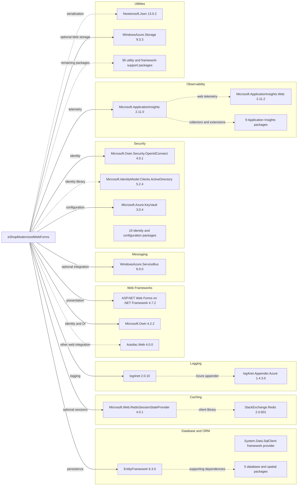

# Dependency Map

The eShopModernizedWebForms application declares 147 NuGet package entries in `src/eShopModernizedWebForms/packages.config`; this includes framework-support and transitive package entries as well as application-facing libraries.

## Dependencies

### Dependency Summary

| Category | Count | Key Libraries | Notes |
|---|---:|---|---|
| Web Frameworks | 14 | ASP.NET Web Forms, Microsoft.Owin, Autofac.Web | Full .NET Framework web stack |
| Database / ORM | 5 | EntityFramework 6.3.0, Microsoft.Data and System.Spatial packages | SQL Server is the configured relational store |
| Messaging | 1 | WindowsAzure.ServiceBus 6.0.0 | Declared package; no runtime usage was identified in application source |
| Caching | 2 | Redis session provider, StackExchange.Redis 2.0.601 | Session-related packages; the sample Redis provider configuration is commented out |
| Logging | 2 | log4net 2.0.10, Azure appender 1.4.3.0 | Application logging and optional Azure target |
| Security | 19 | OWIN OpenID Connect, Azure Key Vault, IdentityModel | Supports optional identity and external configuration |
| Observability | 9 | Application Insights 2.11.0 and collectors | Several telemetry integrations are declared |
| Utilities | 95 | Newtonsoft.Json 13.0.2, WindowsAzure.Storage 9.3.3 | Includes framework support and transitive packages |

### Version & Compatibility Risks

The application targets .NET Framework 4.7.2 and uses legacy Web Forms, EF 6.3, OWIN, and older Azure SDK packages. Moving to a modern .NET target requires substantial framework and application changes; the .NET 10 upgrade assessment records package incompatibilities and project-format work.

### Notable Observations

- The package inventory includes 147 entries because `packages.config` lists framework-support dependencies alongside primary libraries.
- Application Insights, Azure Storage, Key Vault, and Redis packages are present, but their use is configuration-dependent.
- WindowsAzure.ServiceBus is declared, though no corresponding runtime call was found in source.
- No test-scoped package entries or separate test project were detected in this workspace.

## Test Dependencies

| Framework | Version | Notes |
|---|---|---|
| None detected | — | No test-scoped packages or test project found in the target solution |

Total test-scope dependencies: 0

No test dependencies were detected in the solution package manifest.
