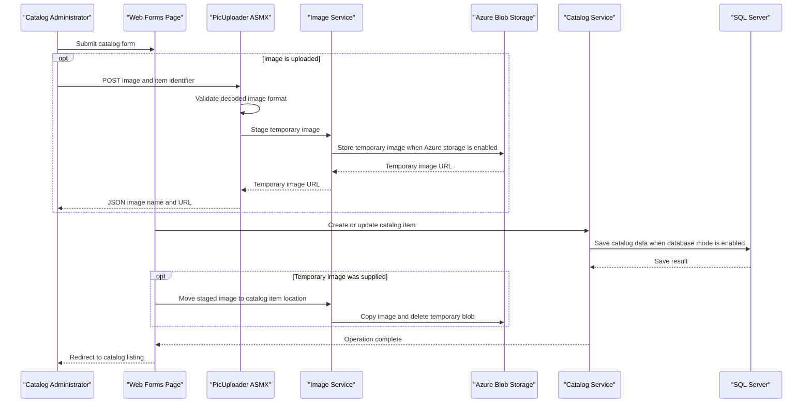

# API & Service Communication Contracts

The application exposes server-rendered catalog pages and one script-enabled image-upload service. Its catalog and persistence operations are synchronous calls within the web application; no service-to-service API or asynchronous messaging flow was identified.

## Service Catalog

| Service | Port | Category | Purpose |
|---|---:|---|---|
| eshop.modernized.webforms | 80 (host mapping 5114) | API Layer | Serves catalog pages and the image-upload endpoint |
| sql.data | 1433 (host mapping 5433) | Infrastructure | SQL Server instance used by the application when database mode is enabled |
| Azure Blob Storage | External | Infrastructure | Optional image storage backend |
| Microsoft Entra ID | External | Infrastructure | Optional OpenID Connect identity provider |

The application and SQL Server are defined in Docker Compose. Azure services are external integrations rather than independently deployed solution projects.

## API Endpoints Inventory

| Service | Method | Path | Request Type | Response Type |
|---|---|---|---|---|
| Web Forms | GET / POST back | `/Default` | Optional pagination route values | Rendered catalog page |
| Web Forms | GET / POST back | `/Default/index/{index}/size/{size}` | Integer route values | Rendered catalog page |
| Web Forms | GET / POST back | `/Catalog/Create` | Form values for a catalog item | Rendered form or redirect |
| Web Forms | GET / POST back | `/Catalog/Edit/{id}` | Item ID and form values | Rendered form or redirect |
| Web Forms | GET | `/Catalog/Details/{id}` | Item ID | Rendered item details |
| Web Forms | GET / POST back | `/Catalog/Delete/{id}` | Item ID and confirmation postback | Rendered form or redirect |
| PicUploader | POST | `/Catalog/PicUploader.asmx/UploadImage` | Multipart upload with `HelpSectionImages` and `itemId` | JSON object with temporary image name and URL; 400 for invalid images |

The Web Forms routes are registered in `RouteConfig`; the ASMX method is marked as a script service and returns JSON.

## Management & Observability Endpoints

| Service | Endpoint | Custom Metrics |
|---|---|---|
| Web Forms | No dedicated health, metrics, or Swagger endpoint identified | Application Insights telemetry is configured; no custom metric endpoint was found |

## DTOs & Contracts

`CatalogItem`, `CatalogBrand`, and `CatalogType` are the service-level domain entities used by the catalog pages and persistence layer. `PaginatedItemsViewModel<CatalogItem>` is the catalog listing response model. The image uploader accepts a multipart file and item identifier and returns a small JSON object containing the staged image name and URL. No immutable DTO records, OpenAPI/Swagger specifications, protobuf schemas, or GraphQL schemas were found. `JavaScriptSerializer` serializes the uploader response.

## Communication Patterns

- **Synchronous:** browser-to-Web-Forms HTTP requests, in-process calls from pages to catalog/image services, EF6 calls to SQL Server, and optional Azure Blob SDK calls.
- **Asynchronous messaging:** no application use of a message broker or event bus was identified; a Service Bus package is declared.
- **Resilience:** no explicit retry, circuit-breaker, timeout, or bulkhead policy was identified for SQL or blob operations.
- **Service discovery and gateway:** no service discovery or API gateway is present; Docker Compose uses the SQL service name for local connectivity.
- **Security:** OpenID Connect with Microsoft Entra ID is conditional on configuration. When that mode is disabled, a custom middleware creates a claims identity rather than authenticating credentials. No explicit TLS requirement or authorization policy for the image-upload method was identified.

## Service Technology Matrix

| Service | Web | Data Access | Discovery | Gateway | Health | Cache | Metrics |
|---|---|---|---|---|---|---|---|
| eshop.modernized.webforms | ASP.NET Web Forms | EF6 / SQL Server | None | None | None identified | Optional Redis session package; configuration commented | Application Insights |
| sql.data | SQL Server | Native database | None | None | Compose health check | None identified | None identified |
| Azure Blob Storage | Azure Storage SDK | Blob objects | None | None | None identified | Not applicable | None identified |

## Service Communication Sequence

