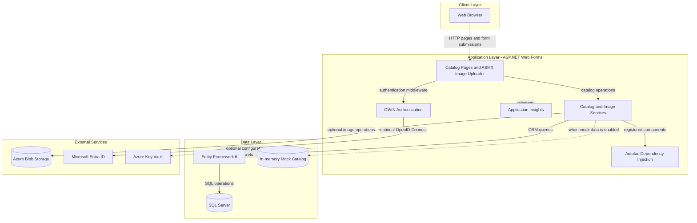
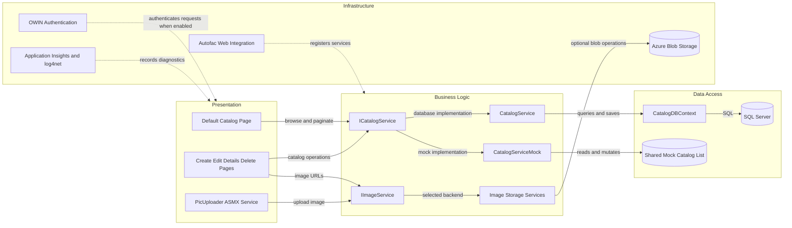

# Architecture Diagram

This application is a server-rendered catalog management site with optional SQL Server persistence and Azure Blob image storage. The diagrams summarize the application layers and the principal interactions between its components.

## Application Architecture

### Technology Stack Summary

| Layer | Technology | Version | Purpose |
|---|---|---:|---|
| Presentation | ASP.NET Web Forms | .NET Framework 4.7.2 | Server-rendered catalog pages and image upload service |
| Authentication | OWIN and OpenID Connect | OWIN 4.2.2; OpenID Connect 4.0.1 | Optional Microsoft Entra ID sign-in |
| Business services | C# catalog and image services | .NET Framework 4.7.2 | Catalog CRUD and image operations |
| Dependency injection | Autofac | 4.9.4 | Web Forms property injection and service registration |
| Persistence | Entity Framework 6 | 6.3.0 | SQL Server catalog data access |
| Observability | Application Insights and log4net | 2.11.x; 2.0.10 | Request telemetry, tracing, and logging |

### Data Storage & External Services

SQL Server is the persistent store when mock data is disabled; the default configuration uses a mock catalog service. Azure Blob Storage is an optional image backend. Optional integrations include Microsoft Entra ID for sign-in, Azure Key Vault for configuration, and Application Insights for telemetry. No message broker or application cache is used by the catalog service.

### Key Architectural Decisions

- Autofac selects mock or database-backed catalog services and local or Azure image storage from configuration flags.
- Entity Framework 6 and a SQL connection factory isolate persistence from the catalog pages.
- The application is a single Web Forms deployment; service calls are in-process, with SQL Server and optional Azure services outside the process.

## Component Relationships

### Component Inventory

| Component | Layer | Type | Responsibility |
|---|---|---|---|
| Default Catalog Page | Presentation | Web Forms page | Lists and paginates catalog items |
| Create, Edit, Details, Delete Pages | Presentation | Web Forms pages | Catalog item administration and display |
| PicUploader | Presentation | ASMX script service | Validates and stages uploaded catalog images |
| ICatalogService | Business Logic | Service interface | Defines catalog queries and mutations |
| CatalogService | Business Logic | EF-backed service | Implements catalog operations using the database context |
| CatalogServiceMock | Business Logic | Mock service | Implements catalog operations with an in-memory list |
| IImageService and storage services | Business Logic | Service interface and implementations | Build image URLs and manage local or blob-backed images |
| CatalogDBContext | Data Access | Entity Framework DbContext | Maps catalog entities to SQL Server tables |
| ApplicationModule | Infrastructure | Autofac module | Selects service implementations from configuration |
| Startup and Startup.Auth | Infrastructure | OWIN startup | Configures middleware and optional OpenID Connect |
| Global | Infrastructure | ASP.NET application lifecycle | Initializes routes, dependency injection, database, and telemetry |
