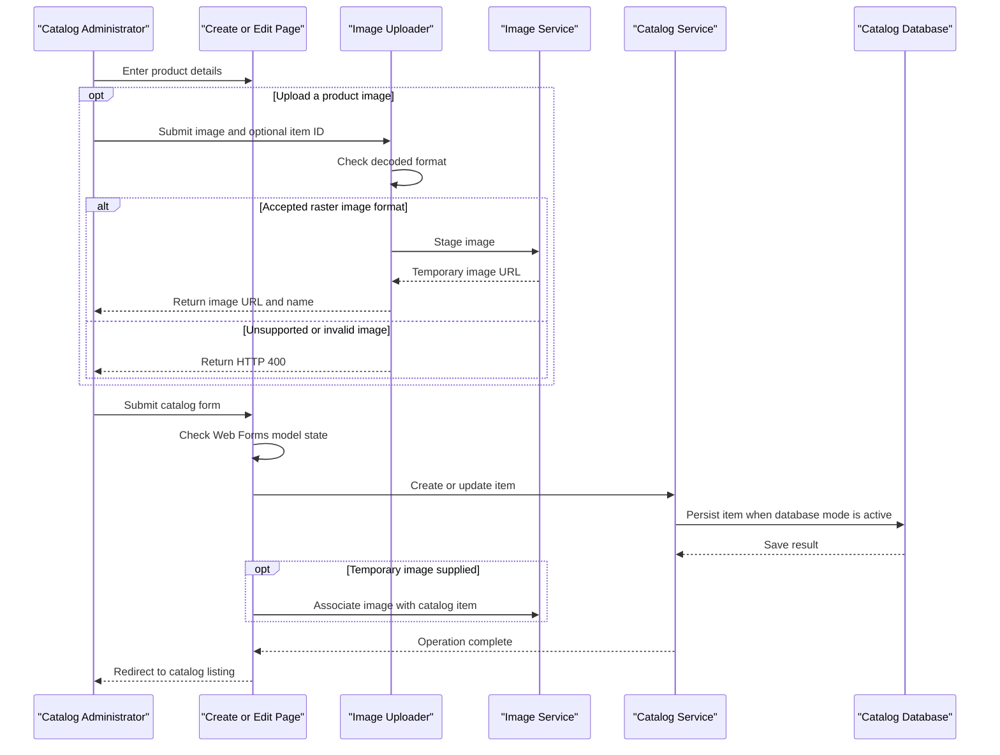

# Core Business Workflows

The application lets users browse a product catalog and lets catalog administrators create, update, inspect, and delete catalog items. Product images can be staged and stored separately from catalog metadata.

## Domain Entities

| Entity | Service / Bounded Context | Description | Key Relationships |
|---|---|---|---|
| CatalogItem | Catalog Management | Product offered in the catalog, including price and inventory data | Belongs to one CatalogBrand and one CatalogType |
| CatalogBrand | Catalog Management | Brand classification used to group catalog products | Can be referenced by multiple CatalogItems |
| CatalogType | Catalog Management | Product type classification | Can be referenced by multiple CatalogItems |

## Service-to-Domain Mapping

| Service | Domain Context | Owned Entities | External Dependencies |
|---|---|---|---|
| eShopModernizedWebForms | Catalog Management | CatalogItem, CatalogBrand, CatalogType | SQL Server or in-memory mock data; optional Azure Blob Storage |

There are no independently deployed domain services or cross-context data exchanges in this solution. The web application is the source of truth for catalog data.

## Primary Workflows

### Workflow 1: Browse the catalog

1. A visitor opens the catalog page, optionally providing page index and page size through the page route.
2. The page asks `ICatalogService` for a paginated catalog result.
3. The selected service implementation retrieves catalog items from EF6/SQL Server or the mock catalog list.
4. The page resolves image URLs through `IImageService`, binds item data, and renders navigation links.

### Workflow 2: Create or update a catalog item

1. An administrator opens the create or edit page. When Entra ID sign-in is enabled, an unauthenticated page request initiates an OpenID Connect challenge.
2. The administrator submits catalog and inventory values; the page checks its Web Forms model state and constructs a `CatalogItem`.
3. `CatalogService` allocates an identifier when needed and saves the item through EF6, or the mock service mutates its in-memory list.
4. If a staged image is supplied, the image service associates it with the item and returns the user to the catalog listing.

### Workflow 3: Upload and stage an image

1. The browser submits an image and optional item identifier to `PicUploader.UploadImage`.
2. The uploader checks the decoded format against JPEG, PNG, and GIF, then asks the selected image service to stage the upload.
3. Azure mode stores the temporary blob and returns its URL; mock mode returns the default image when no matching local catalog picture exists.
4. During item creation or editing, the page asks the image service to move the staged image to the item location.

### Workflow 4: Delete a catalog item

1. An administrator opens the delete page for an item identifier.
2. The page loads the item through `ICatalogService` and displays its details.
3. On confirmation, the catalog service removes the entity from SQL Server or the mock list and the page redirects to the catalog.

## Cross-Service Data Flows

No service-to-service aggregation or cross-service business flow was identified. The browser communicates with a single Web Forms application; that application accesses SQL Server for catalog metadata and optionally Azure Blob Storage for image content. If SQL Server is unavailable in database mode or Blob Storage is unavailable in Azure storage mode, no explicit business fallback or circuit-breaker policy is configured.

## Business Workflow Sequence

## Business Rules & Decision Logic

- A catalog item is associated with a catalog brand and catalog type; EF mapping requires both relationships.
- Price and stock model annotations constrain expected numeric values; page event handlers also require model-state validity before creating or saving an item.
- The image uploader accepts decoded JPEG, PNG, or GIF formats and returns HTTP 400 for invalid image data.
- Item identifiers are generated by the SQL HiLo sequence in database mode and incremented from the current maximum in mock mode.
- `UseMockData`, `UseAzureStorage`, and `UseAzureActiveDirectory` select alternative implementations or authentication behavior.
- Database mutations are synchronous saves through EF6. No explicit transaction orchestration across services, compensating actions, or business audit trail was identified.
