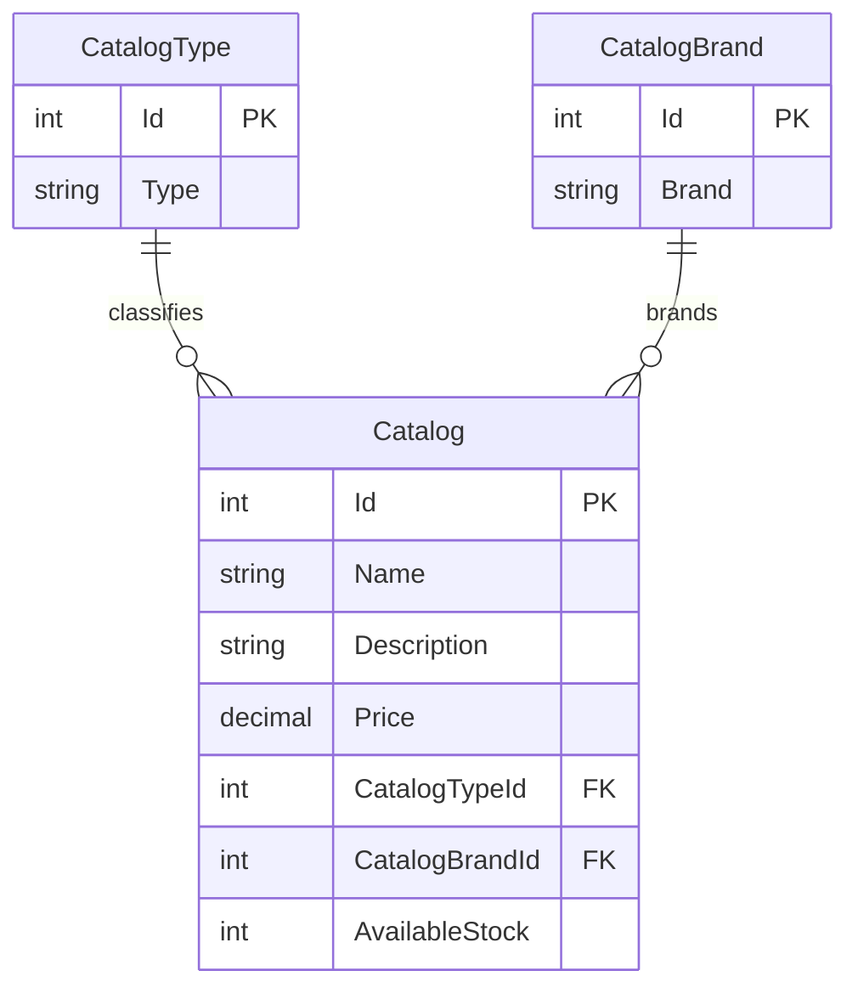

# Data Architecture & Persistence Layer

The catalog domain contains three persisted entity types backed by Entity Framework 6 and SQL Server, with an in-memory mock implementation available for local/demo configuration. Image data is stored either in the web application's local image directory or optionally in Azure Blob Storage.

## Database Configuration

| Service/Module | DB Type | Profile | Driver | Connection | Migration Tool |
|---|---|---|---|---|---|
| eShopModernizedWebForms | SQL Server | Database mode (`UseMockData=false`) | System.Data.SqlClient | `CatalogDBContext` connection string; local Compose host mapping uses port 5433 and container uses 1433 | No migration tool detected; `CreateDatabaseIfNotExists` initializer and SQL sequence scripts |
| eShopModernizedWebForms | In-memory collection | Mock mode (default `UseMockData=true`) | Not applicable | Process memory | Not applicable |

The initializer seeds catalog types, brands, and items from predefined data or optional CSV files. SQL sequence scripts initialize ID allocation. See `configuration-inventory.md` for the configuration sources and secret references.

## Data Ownership per Service

| Service | Tables Owned | ORM Framework | Caching | Notes |
|---|---|---|---|---|
| eShopModernizedWebForms | `Catalog`, `CatalogBrand`, `CatalogType` | Entity Framework 6 | No entity cache; mock mode keeps data in a process-wide list | A single application owns the catalog data |
| sql.data | SQL Server database for the application | SQL Server | None identified | Compose infrastructure used by database mode |

## Entity Model

`CatalogType` is mapped to the `CatalogType` table in `Models/CatalogType.cs`; `CatalogBrand` maps to `CatalogBrand` in `Models/CatalogBrand.cs`; and `CatalogItem` maps to `Catalog` in `Models/CatalogItem.cs`. `CatalogDBContext` configures required foreign-key relationships from catalog items to brands and types. `PictureUri` and `TempImageName` are ignored by the EF mapping.

## Key Repository Methods

| Service | Repository | Notable Methods | Purpose |
|---|---|---|---|
| eShopModernizedWebForms | `CatalogService` (`Services/CatalogService.cs`) | `GetCatalogItemsPaginated(pageSize, pageIndex)`, `FindCatalogItem(id)`, `GetCatalogTypes()`, `GetCatalogBrands()` | Query catalog pages and reference data |
| eShopModernizedWebForms | `CatalogService` (`Services/CatalogService.cs`) | `CreateCatalogItem(item)`, `UpdateCatalogItem(item)`, `RemoveCatalogItem(item)` | Persist catalog mutations through the DbContext |
| eShopModernizedWebForms | `CatalogItemHiLoGenerator` (`Models/CatalogItemHiLoGenerator.cs`) | `GetNextSequenceValue(db)` | Allocates catalog item identifiers using a SQL sequence and local low-range counter |

There is no separate repository interface; `CatalogService` performs data access through `CatalogDBContext`.

## Caching Strategy

No catalog query cache is configured. Mock data is held in an in-memory list by the singleton mock service. Redis and a Redis session-state provider are included as packages, but the session-state provider example in `Web.config` is commented out and no active Redis cache configuration was identified.

## Data Ownership Boundaries

The solution contains one application domain and one catalog database; no cross-service data access or CQRS split was identified. Catalog pages call the catalog service, which queries or updates SQL Server through EF6. Image content is handled separately by the selected image service and is not stored as catalog entity content. Mock mode replaces database operations with an in-memory catalog list.

### Data Classification & Sensitivity

| Entity | Sensitive Fields | Classification (PII/PHI/PCI/None) | Controls in Place |
|---|---|---|---|
| CatalogItem | Product description, inventory and pricing data | None | No sensitive personal or payment fields in the model |
| CatalogBrand | Brand name | None | No sensitive fields |
| CatalogType | Product type name | None | No sensitive fields |

No PII, PHI, or PCI data was identified in the catalog entity model.
