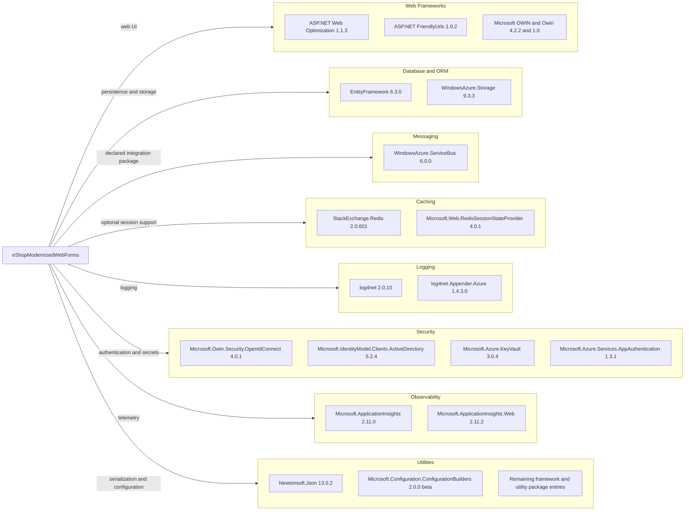

# Dependency Map

The eShopModernizedWebForms project uses NuGet packages recorded in `src/eShopModernizedWebForms/packages.config`. The manifest contains 147 package entries, including framework support packages; the diagram highlights the principal external dependencies.

## Dependencies

### Dependency Summary

Counts below describe individually shown representative packages, not every package entry in `packages.config`.

| Category | Count | Key Libraries | Notes |
|---|---:|---|---|
| Web Frameworks | 3 | ASP.NET Web Optimization, FriendlyUrls, OWIN | Legacy System.Web integration |
| Database and ORM | 2 | Entity Framework 6, WindowsAzure.Storage | SQL Server ORM and optional blob SDK |
| Messaging | 1 | WindowsAzure.ServiceBus | Package is declared; no application-level messaging flow was identified |
| Caching | 2 | StackExchange.Redis, Redis session provider | Redis session configuration is commented out |
| Logging | 2 | log4net, Azure appender | Application tracing and logging integrations |
| Security | 4 | OWIN OpenID Connect, IdentityModel, Key Vault, App Authentication | Authentication and secret access integrations |
| Observability | 2 | Application Insights, Application Insights Web | Telemetry and request instrumentation |
| Utilities | 2 plus aggregate | Newtonsoft.Json, configuration builders, remaining packages | Includes extensive System.* and support-package entries |

### Version & Compatibility Risks

The project targets .NET Framework 4.7.2 and uses a legacy non-SDK Web Forms project with a large `packages.config` dependency set. Several packages are old or use beta configuration-builder versions; the security scan also found medium-severity advisories affecting the declared log4net and IdentityModel packages. Upgrading to .NET 10 requires a Web Forms migration path rather than a framework-only target change.

### Notable Observations

- Entity Framework 6.3.0 is used with a manually configured SQL Server context; no EF Core dependency is declared.
- Redis and Azure Service Bus packages are present, but no active cache or message-broker flow was identified in the application source/configuration.
- Application Insights, log4net, OWIN, and Azure integrations account for multiple overlapping telemetry and platform support packages.
- The manifest contains 147 package entries, while the project has no test-scoped package entries.

## Test Dependencies

| Framework | Version | Notes |
|---|---|---|
| None detected | — | No test-scoped packages or test project were found in this solution. |

Total test-scope dependencies: 0

No test dependencies detected.
